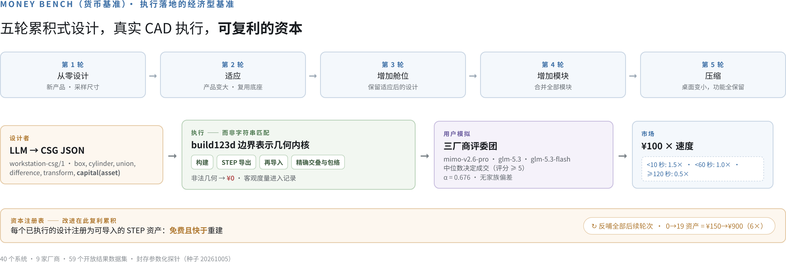
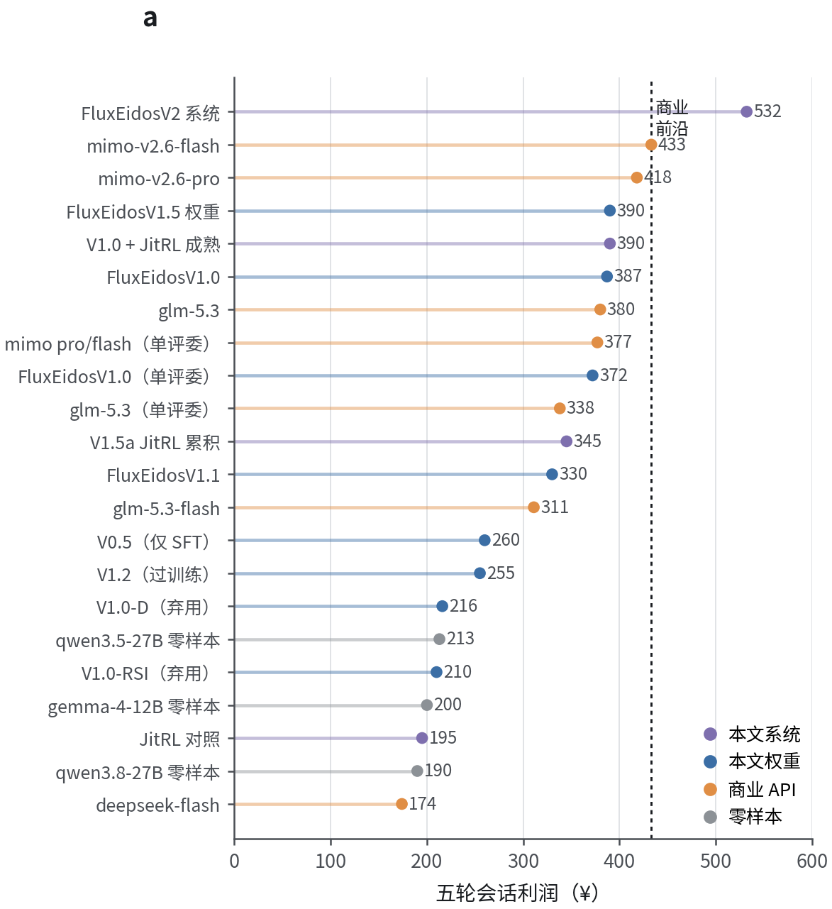
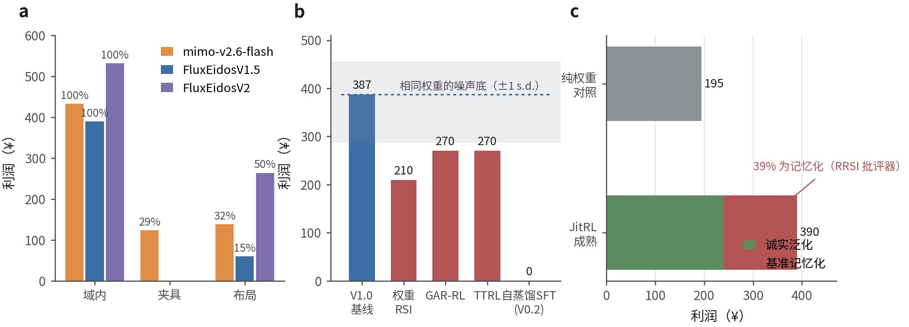
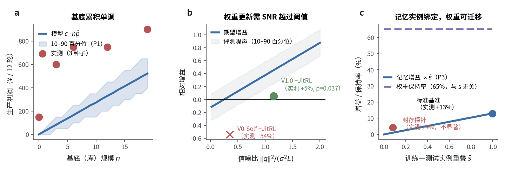
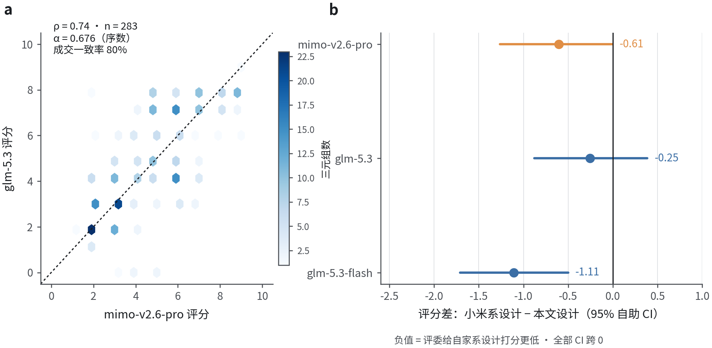

# 机器制造模型的自我改进存在于基底之中，而非权重之中

**Exuberant Witness** *¹*

¹ MechanogenesisBench 项目（单位信息待补全）

通信作者：通信作者邮箱待补全

---

## 摘要

大语言模型正越来越多地被用于设计物理造物，一个不断壮大的文献群正通过"经验"改进这类任务——在自生成数据上微调、在权重上做强化学习，或在冻结的模型周围积累记忆与技能。然而，改进究竟发生在何处，此前从未被度量。本文提出 Money Bench（货币基准），以经济学方式为该问题定价：在五轮累积式产品设计中，一个设计只有当它能够以真实计算机辅助设计几何执行（build123d 边界表示：构建、STEP 导出、再导入、精确测量）、满足充任客户的三厂商评委团、并且交付速度落入速度分层定价的付费档位时，才能赚到钱；每个已执行的设计随即注册为可导入的资本，供后续轮次使用——改进便像真实车间一样复利累积。在对 9 家厂商 39 个系统的评测中，我们发现：(1) 领域迁移令所有系统的收入崩塌，最强商业模型仅保留域内利润的 29–32%；(2) 在 90 亿参数规模上，我们测试的四类权重级自我改进全部无法改进已训练基线——因为重复评测的噪声底（相同权重下每会话 ±¥85）高于约 30 个样本的生成预算下单次更新的漂移量；(3) 跨会话经验收益的 39% 是基准记忆化——由筛除自相似记忆的正则化所揭示。一个极简形式模型解释了全部三项发现——经验证的基底单调累积、梯度更新继承信噪比阈值、记忆是实例绑定的——并给出两因素分工的处方：权重训练在阈值以下是大头（零样本基座均值仅 ¥30、中位 ¥0；同一套复用栈只能将其抬到 ¥154；带执行验证奖励的门控微调与强化学习将权重带到 ¥372–390——而发现 (2) 表明基线训成之后这类更新便不再划算），此后进一步改进应冻结权重、复利经验证的基底——五机制推理时技术栈在主口径上每会话增益 ¥48–142，并在对称三厂商评审下让训练后的 90 亿参数开源模型超越最强商业前沿（¥532 对 ¥433，*P* = 0.0015，Cohen's *d* = 1.0，*n* = 40；单评委口径下持平，¥438）——而精选资产库让另一条生产口径复利六倍、跨会话经验使会话内收入翻倍（其中 39% 为基准记忆化，已筛除并排除在泛化主张之外）。整条谱系端到端训练仅用一块消费级 GPU。

---

## 引言

机器制造——设计必须可装配、可配合、可销售的物理造物——正在成为语言模型的任务。神经 CAD 生成已从操作序列¹⁴发展到文本条件设计¹⁵，再到编写 CAD 代码的语言模型¹⁶；执行验证型基准已成为评测编程智能体的标准⁹,¹⁰。自然的下一个问题是经济学问题：当模型积累制造机器的经验时，系统是否赚到更多钱——收益究竟存在于权重、记忆，还是造物之中？

该领域的默认答案是权重。自训练回路将自生成解筛回微调¹⁻³；自奖励模型自举自身的偏好信号²；强化学习直接塑造推理⁴，其建立在偏好学习基础²¹与指令微调体系²²之上，样本规模大得多。另一条平行路线改进的是系统而非参数：情景记忆中的言语反思⁵、可执行技能库⁶、操作系统式记忆管理⁷、记忆流智能体⁸；思维链提示与自洽性²³,²⁴证明了显著收益无需任何训练，工具使用与行动框架²⁵,²⁶则将其扩展到智能体。这两族方法很少在同一把尺子上比较，而现有 CAD 基准¹⁴⁻¹⁶度量的是单次静态质量，而非累积经济学。

本文提出 Money Bench，为这一问题定价（图 1）。五轮累积需求——从零设计、适应、扩展、组合、压缩——驱动的设计必须以真实 build123d 边界表示几何执行，执行失败则一无所获。三厂商评委团模拟客户；售出支付 ¥100 × 速度乘数，越快越值钱；每一轮的合格设计注册为可导入的资本——免费且快于重建。复利是可度量、可归因、可审查的。在对 9 家厂商 39 个系统的评测中（图 2），我们得到三项结果（图 3）：领域迁移令所有系统的收入崩塌；90 亿参数规模的权重级自我改进被噪声主导，我们测试的四类方法全部从已训练基线倒退；测试时经验收益的 39% 是基准记忆化。一个极简形式模型统一三者（图 5）：经验证基底的累积单调且无阈值，梯度更新继承信噪比阈值，记忆随训练—测试实例重叠度缩放。模型的两因素处方——权重训练一次性跨过阈值，然后冻结权重、改进基底——使我们训练后的 90 亿参数系统在对称评审下超越商业前沿（图 4），边界条件如实报告（图 5c，见结果）。

{width=16cm}

---

## 结果

### 领域迁移令所有系统的收入崩塌

在两个未见过的任务域——机械加工夹具设计与生产线布局——上，每个系统的收入都大幅下降（图 3a；三评委协议，每格 *n* = 5 会话）。最强商业模型仅保留域内利润的 29%（夹具）与 32%（布局）（¥433 → ¥124 与 ¥138）。我们的纯权重模型呈同一定性模式（¥390 → ¥0 与 ¥60；表 1）。这把尺子暴露的是领域难度现象，而非某个模型的个别弱点。

Table: 多领域利润（¥/会话，三评委中位数，n = 5）

| 系统 | 工作台（域内） | 夹具 | 布局 |
|---|---:|---:|---:|
| mimo-v2.6-flash | 433 | 124 | 138 |
| FluxEidosV1.5（本文） | 390 | 0 | 60 |
| FluxEidosV2（本文） | 532 | 0 | **264** |

### 权重级自我改进在 90 亿参数规模被噪声主导

从已训练基线（FluxEidosV1.0，¥372–387）出发，四类权重级自我改进全部倒退或停滞（图 3b）：权重自更新谱系降至 ¥210（−44%，且其探针收益不迁移）；组内优势重分配²⁷在学习率 2×10⁻⁵ 时降至 ¥270，并伴随格式遗忘（有效设计在三代内从 33/36 跌至 1/36）；在线测试时强化学习¹⁷,¹⁸降至 ¥270；自蒸馏微调则因格式污染崩塌至 ¥0。根因可被度量：*相同权重*的重复评测在十次探针会话中跨越 ¥38–225（*n* = 10，±1 s.d. ≈ ¥85），而每一代强化学习只携带约 30 个设计。在这样的样本预算下，单次更新的漂移无法越过评测噪声底——经典干扰问题¹⁹,²⁰在语言模型规模上的样本预算面孔。那些著名的自训练成功案例¹⁻³，样本量高出四到六个数量级。与本文谱系的对照是阶段依赖而非自相矛盾：同一套权重更新机制用在阈值以下——从 SFT 阶段出发的 CARE 强化学习，用执行验证的 CAD 奖励与 draft/improve/debug 混合域（见方法）——十二轮迭代带来 +¥110（¥260 → ¥372–390），因为信号项还很大；用在已训练基线上，同类更新便撞上噪声底，正如 (P2) 所预言。

### 测试时经验收益的 39% 是基准记忆化

跨会话经验累积（优势加权记忆库，JitRL 式；见方法）使相同权重的利润翻倍（¥195 → ¥390，*P* = 0.037；图 4b）。以"记忆与基准实例的相似度"筛除记忆的正则化（RRSI 式；见方法）拒绝了在基准需求上检索到的 21 条记忆中的全部 21 条（自相似度 = 1.0）。分解如下（图 3c）：¥240 诚实泛化 + ¥150 基准记忆化——这是训练数据记忆化¹²,¹³在评测侧的对应物，在此被度量、被正则化、并被排除在泛化主张之外。

{width=9cm}

### 经验证的基底复利累积

权重冻结后，改进存在于三种基底之中（图 4）。其一，执行验证资产的精选库：每 12 轮的生产利润随库规模单调上升——0、3、6、12、19 个资产对应 ¥150、600、750、750、900（Spearman ρ = 0.96；3/3 随机种子单调；图 4a）。资产即 STEP 文件：验证一次，永不遗忘，复用免费且快速——速度定价直接奖励它们。其二，跨会话经验在第 10 个会话将利润翻倍（图 4b）。其三，同一套冻结权重上的五机制推理时技术栈——按结构细节 CAD 筛选的三选一候选生成、系统自产评分 ≥6 设计的上下文内回放、语法修复层、条件性重采样、评委重试——每个机制经消融逐一隔离（每个版本 5–20 会话；见方法）。

### 完整技术栈在对称评审下超越商业前沿

在对称三厂商协议下（mimo-v2.6-pro、glm-5.3 与 glm-5.3-flash 对相同设计评分取中位数），技术栈每会话赚取 ¥532（中位数 ¥540，*n* = 40），最强商业模型为 ¥433（*n* = 14）：+23%，Mann–Whitney *P* = 0.0015，Cohen's *d* = 1.0（图 4c）。重采样歧义边界（悲观 ¥489 至乐观 ¥564；见方法）全部高于前沿。在单评委协议下，同一批会话赚取 ¥438——持平（*P* = 0.39）——因为单评委系统性地把我们的设计压在成交阈值附近，而 glm 评委不会；下方的家族偏差审计表明这是评委宽严结构，而非厂商俘获，且对称协议对每个系统一视同仁。技术栈还直接赢下布局域（¥264 对 ¥138，*P* = 0.029；表 1）——基底机制在模型高于能力阈值之处皆可迁移。成本：端到端一块消费级 GPU（QLoRA SFT 加十二轮强化学习迭代），起点是零样本仅赚 ¥30（中位 ¥0）的基座权重。

### 极简形式模型及其处方的适用边界

三个命题组织起全部发现（图 5；证明见补充信息）。**(P1) 基底单调性：** 若资产仅在执行验证后入库，累积价值 V(n) = c·Binomial(n, p) 在期望上单调，对能力 p 没有阈值。**(P2) 权重更新阈值：** 一步 Δθ = η(g + ε)（噪声方差 σ²、零均值）使真实性能改变 η‖g‖² − η²σ²L/2；观测到的改进还会被评测噪声掩蔽，因此只有越过信噪比阈值才能检出改进——这是一个基底所没有的能力阈值。**(P3) 记忆实例绑定：** 回放收益随训练—测试重叠度 s̄ 缩放，而权重级能力以与重叠无关的保持率迁移。每项预测均被验证：剂量—响应 ρ = 0.96（图 5a）；阈值以下的经验累积放大噪声（弱模型上 −54%，阈值以上 +5%，*P* = 0.037；图 5b）；同分布回放收益 +13%，而封存探针收益 +4%（不显著，*P* = 0.40），权重保留 65% 的域内利润（图 5c）。阈值同样划分领域——夹具位于阈值以下（各轮评分 2.4–3.6；没有任何设计达到 6，故该域的经验库从未累积），布局位于阈值以上——也划分系统：同一套技术栈放在未训练基座权重上只能到 ¥154（*n* = 5），而不带任何栈的训练权重有 ¥390（扩展数据表 3），2×2 因子对照中权重贡献更大的边际，技术栈在其上叠加。记忆在同分布内取胜；权重在跨域时取胜；两种基底的迁移画像互不相交。

{width=16cm}

{width=16cm}

{width=16cm}

### 无真人情况下的评委有效性：共识、偏差审计与执行骨架

本研究未做人类被试实验；我们以三项机器可审计的保障替代（图 6）。其一，对称跨厂商协议：在跨设计者、跨领域的 283 个完整评判三元组上，序数 Krippendorff α = 0.676，两两 Spearman ρ = 0.66–0.74，对成交判定——经济体系实际定价的那个操作性决策——的一致率为 75–81%。其二，家族偏差审计：小米评委并不偏袒小米设计；其评分差（小米设计减去我们的设计）为 −0.61，自助法 95% 置信区间跨零，glm-5.3 为 −0.25（不显著）。其三，执行落地的骨架：CAD 合法性、交叠体积、包络超出、复用率与速度都是客观的几何内核数字，而本文的负结果仅凭这些指标即成立。一项如实的边界限定上述主张：轮评分跟踪的是感知精细度与需求符合度，而非几何精度——在从零设计轮内部，零件数与评分正相关（Spearman ρ = +0.47，*n* = 49），而跨轮型合并后相关性反转（ρ = −0.63），因为零件少的模块复用轮反而评分更高（扩展数据表 4）。本文的全部主张都关于这套体系定价的行为——该评委团下的成交判定——而非产品内在质量。语言模型评委的已知偏差——位置、冗长、自我增强¹¹——恰恰是这套结构要中和的对象。

{width=16cm}

---

## 讨论

Money Bench 上的改进有两个截然不同的来源，一组 2×2 对照将其分开（扩展数据表 3）。权重训练是大头：零样本基座均值仅 ¥30（中位 ¥0；25 轮仅 1 次成交），即便配上同一套推理时技术栈，未训练权重也只能到 ¥154（n = 5；25 轮中 6 轮成交），而不带任何栈的训练权重就有 ¥390。技术栈在训练权重之上叠加真实但次要的增益（单评委 ¥438，对称评审 ¥532）——两个因子可组合，权重在先。阈值以下，累积甚至会倒扣（弱自训模型上 −54%），同一阈值也划分任务领域。机制上顺理成章：验证是离散、无噪声的门，基底累积按构造单调；梯度步接受连续、带噪的增量，其漂移在实践者样本预算下无法越过评测噪声底。因此处方是关于边际回路的——用训练一次性跨过阈值，然后冻结权重、改进基底——它让端到端训练仅用一块消费级 GPU 的 90 亿参数开源模型，在对称、经家族偏差审计的协议下超过了最强商业系统。

三条边界让主张保持诚实。记忆是实例绑定的：在封存参数化探针上，回放优势消失（+4%，不显著），而权重保留 65%——记忆服务于车间内的复利，权重服务于跨域的触达。能力阈值是真实的：阈值以下，经验累积放大噪声（弱模型上 −54%），整个领域可以位于阈值以下。跨会话经验收益的 39% 是基准记忆化——由正则化度量，而非假设其不存在。

更宏观地说，Money Bench 贡献了一种评测哲学：用经济体系为行为定价，用物理执行加以验证，通过资本注册表使复利可观测，并像审计仪器一样审计评委。四要素皆可迁移到 CAD 之外：任何具有可执行造物的智能体领域——代码、文档、实验方案——都容纳同样的结构。尺子、失败、模型与数据全部开放。

---

## 方法

**基准协议。** 每个会话运行五轮工作台产品族上的累积需求（手机座；封存探针实例从四个产品族、三种舱位类型、三种次级模块中采样，尺寸与桌面在固定区间内均匀采样；种子 20261005，从未用于训练）。第 1 轮为从零设计；第 2–5 轮要求适应、扩展、组合与压缩，后续需求明确要求复用早期模块。一个设计是 CSG JSON（workstation-csg/1：box、cylinder、union、difference、transform、capital）。真实执行：设计以 build123d 边界表示几何构建，导出 STEP，再导入并精确测量（交叠体积、相对桌面足迹的包络超出）。已执行的设计注册为资本资产（STEP 路径），后续轮次可通过 capital(asset_id) 导入。售出支付 ¥100 × 速度乘数（<10 s：1.5×；<30 s：1.2×；<60 s：1.0×；<120 s：0.8×；≥120 s：0.5×）；质量门为 0–10 满意度评分，评分 ≥ 5 成交。

**评审。** 单评委协议：mimo-v2.6-pro 评分取中位数。三评委对称协议：mimo-v2.6-pro、glm-5.3 与 glm-5.3-flash 对相同设计评分取中位数。一致性统计基于 283 个完整评判三元组（序数 Krippendorff α、两两 Spearman、成交判定一致率）；家族偏差差值采用 2,000 次自助抽样的 95% 置信区间。轮评分跟踪感知精细度与需求符合度而非几何精度（评分—精细度审计；扩展数据表 4）。

**模型与系统。** 39 个系统：6 个商业 API（mimo-v2.6-flash/pro、glm-5.3/-flash、deepseek-flash/v4-pro），21 个零样本开源模型（7 个利润非零；14 个因不遵守 schema 利润为 ¥0），12 个谱系条目。FluxEidos 谱系：qwen3.5-9b 基座（零样本 ¥30，中位 ¥0）→ 门控 SFT，约 150 个执行验证的自生成样本（¥260）→ CARE 自适应奖励强化学习——执行验证 CAD 奖励与 draft/improve/debug 混合域——单卡 RTX 4090D 上 QLoRA，12 次迭代（¥260 → ¥372–390）。V2 推理时技术栈运行于冻结的 V1.5 权重：R1 三选一候选按零件数再按交叠 CAD 筛选；自产评分 ≥6 设计的上下文内回放；语法修复；后期轮次带二次重试的条件性重采样；API 零分响应的评委重试。消融 v1→v7（每个 5–20 会话）逐一隔离各机制。重采样歧义：26% 的轮次带有评分 < 5 的重采样产物；悲观/中性/乐观选择策略将三评委重算界定于 ¥489/532/564。

**机制评测。** 权重级四类：权重自更新谱系；组内优势重分配（MiMo 式）；在线测试时强化学习；自蒸馏 SFT。资产库剂量—响应：冻结模型、固定参数化生产实例（4 × 3 轮），库跨代累积，3 个随机种子。经验库：优势加权的 logit 调制，记忆自空库跨会话累积，对照为无记忆组（每臂 *n* = 10）。记忆化分解：相似度筛除正则化拒绝相对当前基准实例自相似度 ≥ 阈值的记忆。

**阈值对照。** 同一套推理时技术栈（R1 三选一 CAD 筛选、会话内资本复用、语法修复、带二次重试的条件性重采样、评委重试）原封不动跑在未训练的基座权重上（无 RL 适配器），*n* = 5 会话，单评委协议。经验库自空库开始，仅累积本臂自身评分 ≥6 的设计（自采语义——V2 臂的库同样只采自其自身谱系的运行）。全部轮次的生成预算提高到 2,000 token（技术栈默认 R1 候选 900、后续轮 1,500），因为基座模型的格式化 JSON 在 900 token 处被截断；被截断掐死的对照测不出复用机制本身。零样本基线一格按标准本地模型协议重跑（2,048-token 预算、每轮双尝试、单评委重试加固）。

**统计。** 如所声明采用双侧或单侧 Mann–Whitney U 检验；Cohen's *d*；Spearman ρ；序数 Krippendorff α；自助法 2,000 次抽样。除所报告的边界外未做多重比较校正；全部逐会话数据在代码仓库中。

**可复现性。** 全部代码（基准、训练、推理栈、分析）、59 个结果数据集、逐次运行的会话产物、评委评分缓存与出图脚本均已开源。未涉及人类被试；全部评分由机器生成。

**数据可用性** 全部基准代码、评测结果与数据集见 MechanogenesisBench 代码仓库。
**代码可用性** 基准、训练与推理栈代码与论文同仓库发布。
**致谢** 待补全。**作者贡献** E.W. 设计基准、运行全部实验并撰写论文。**利益冲突** 作者声明无利益冲突。

---

## 参考文献

1. Zelikman, E., Wu, Y., Mu, J. & Goodman, N. D. 用推理自举推理：STaR。*Adv. Neural Inf. Process. Syst.* **35** (2022).
2. Yuan, W. 等. 自奖励语言模型。arXiv:2401.10020 (2024).
3. Singh, A. 等. 超越人类数据：以自训练扩展语言模型问题求解。arXiv:2312.06585 (2023).
4. DeepSeek-AI. DeepSeek-R1：以强化学习激励大语言模型的推理能力。*Nature* **645**, 633–638 (2025).
5. Shinn, N. 等. Reflexion：具备言语强化学习的语言智能体。*Adv. Neural Inf. Process. Syst.* **36** (2023).
6. Wang, G. 等. Voyager：基于大语言模型的开放式具身智能体。*Trans. Mach. Learn. Res.* (2024).
7. Packer, C. 等. MemGPT：让大语言模型充当操作系统。arXiv:2310.08560 (2023).
8. Park, J. S. 等. 生成式智能体：人类行为的交互式拟像。*Proc. UIST* (2023).
9. Jimenez, C. E. 等. SWE-bench：语言模型能解决真实 GitHub issue 吗？*Proc. ICLR* (2024).
10. Zhou, S. 等. WebArena：面向构建自主智能体的真实网页环境。*Proc. ICLR* (2024).
11. Zheng, L. 等. 用 MT-Bench 与 Chatbot Arena 评测"大模型当评委"。*Adv. Neural Inf. Process. Syst., Datasets Benchmarks* (2023).
12. Carlini, N. 等. 从大语言模型中提取训练数据。*Proc. USENIX Security* (2021).
13. Nasr, M. 等. 从（生产）语言模型规模化提取训练数据。arXiv:2311.17035 (2023).
14. Wu, R., Xiao, C. & Zheng, C. DeepCAD：面向计算机辅助设计模型的深度生成网络。*Proc. ICCV* (2021).
15. Khan, M. S. 等. Text2CAD：从自然语言描述生成序列式 CAD 模型。*Adv. Neural Inf. Process. Syst.* (2024).
16. Rukhovich, D. 等. CAD-Recode：从点云逆向工程 CAD 代码。arXiv:2412.14042 (2024).
17. Sun, Y. 等. 以自监督测试时训练应对分布偏移下的泛化。*Proc. ICML* (2020).
18. Akyürek, E. 等. 测试时训练的惊人有效性。arXiv 预印本 (2024).
19. Kirkpatrick, J. 等. 克服神经网络中的灾难性遗忘。*Proc. Natl Acad. Sci. USA* **114**, 3521–3526 (2017).
20. Parisi, G. I. 等. 神经网络的持续终身学习：综述。*Neural Networks* **113**, 54–71 (2019).
21. Christiano, P. 等. 来自人类偏好的深度强化学习。*Adv. Neural Inf. Process. Syst.* **30** (2017).
22. Ouyang, L. 等. 以人类反馈训练语言模型遵循指令。*Adv. Neural Inf. Process. Syst.* **35** (2022).
23. Wei, J. 等. 思维链提示激发大语言模型的推理。*Adv. Neural Inf. Process. Syst.* **35** (2022).
24. Wang, X. 等. 自洽性提升语言模型的思维链推理。*Proc. ICLR* (2023).
25. Yao, S. 等. ReAct：语言模型中推理与行动的协同。*Proc. ICLR* (2023).
26. Schick, T. 等. Toolformer：语言模型可以自学使用工具。*Adv. Neural Inf. Process. Syst.* **36** (2023).
27. 小米 MiMo 团队. MiMo-V2.6：开放推理模型（组内优势重分配）。模型卡与技术报告 (2026).
28. Brown, T. 等. 语言模型是少样本学习器。*Adv. Neural Inf. Process. Syst.* **33** (2020).
29. Kaplan, J. 等. 神经语言模型的缩放定律。arXiv:2001.08361 (2020).
30. Hu, E. 等. LoRA：大语言模型的低秩适配。*Proc. ICLR* (2022).
31. Dettmers, T. 等. QLoRA：量化大语言模型的高效微调。*Adv. Neural Inf. Process. Syst.* **36** (2023).
32. Cobbe, K. 等. 训练验证器求解数学应用题。arXiv:2110.14168 (2021).
33. Lightman, H. 等. 逐步验证。*Proc. ICLR* (2024).
34. Bommasani, R. 等. 基础模型的机遇与风险。arXiv:2108.07258 (2021).
35. Meta FAIR CodeGen 团队. Code World Model：用于代码生成世界模型研究的开放权重大语言模型。arXiv:2510.02387 (2025).

*随本工作发布的改编方法来源：* JitRL（arXiv:2601.18510 改编）、RRSI 正则化（arXiv:2609.24972 改编）。

---

### 扩展数据（摘要）

**扩展数据图 1 | v1→v7 技术栈消融。** 各机制版本的平均利润（¥72 → ¥206 → ¥350 → ¥368 → ¥440/¥436），每个 5–20 会话。

**扩展数据图 2 | 机制对比。** CARE/GAR/TTRL/自蒸馏 SFT/技能库各臂的轮级成交率。

**扩展数据图 3 | CAD 世界模型。** 预测适配器达到 92% 合法率、69% 精确评分；基于排序器的筛选用例为负结果（学习排序的修复已记录在案）。

**扩展数据表 1 | 完整 39 系统排行榜**，含协议、*n* 与逐次运行离散度（见代码仓库）。

**扩展数据表 2 | 封存探针泛化。** V2 技术栈 ¥341 对纯权重 ¥327（每臂 *n* = 10）；轮级评分。

**扩展数据表 3 | 阈值对照：2×2 因子设计。** 零样本基座均值 ¥30（中位 ¥0；*n* = 5，25 轮中 1 轮成交；2,048-token 预算下 13/25 轮执行为合法 CAD——瓶颈不是输出格式而是设计质量）；基座 + 同一套推理时技术栈 ¥154（*n* = 5 会话：240、150、80、150、150；25 轮中 6 轮成交；s.d. ¥57）；训练权重不带栈 ¥390；训练权重 + 栈 ¥438 单评委（¥532 三评委）。

**扩展数据表 4 | 评分—精细度审计。** 141 个无歧义轮次的零件数与轮评分：合并 Spearman ρ = −0.63（辛普森反转——从零轮为精细度定价，ρ = +0.47，*n* = 49；模块复用轮零件少却评分更高）。仓库数据：parts_rating_audit.json。

---

*正文约 3,300 词（不含方法、参考文献与图注）。补充信息：命题 P1–P3 及证明；形式模型仿真代码。*
